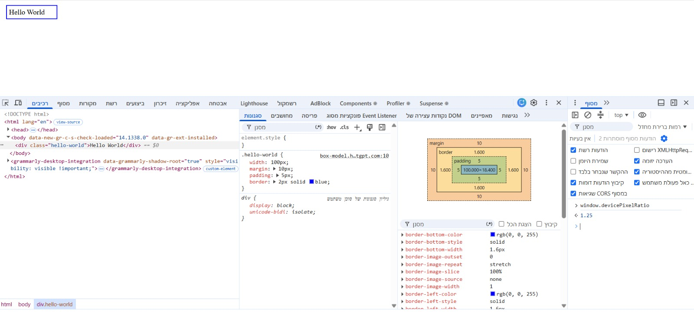
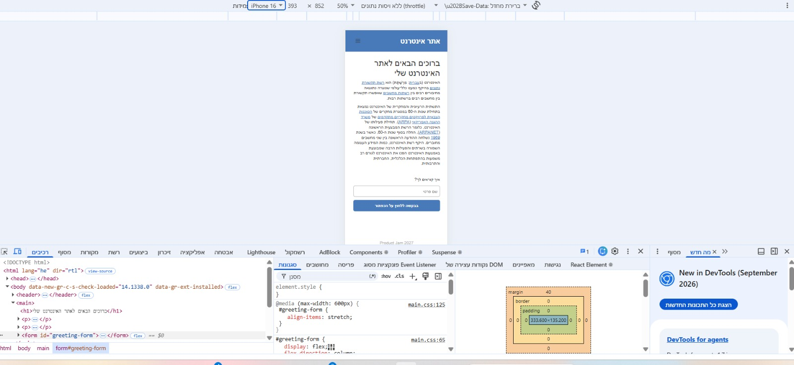
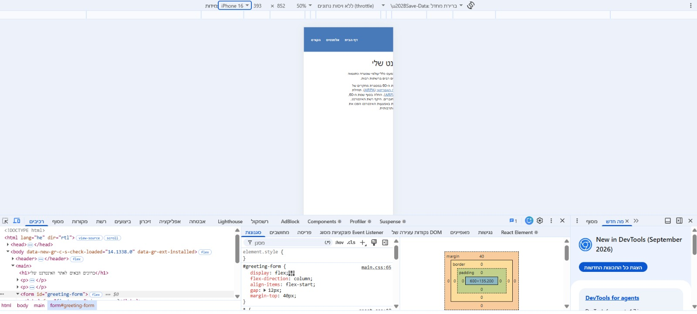

# Answers

Answer the questions below in this file, under each question. Put screenshots in
a `screenshots/` folder and link them from your answers.

## 1. Challenges and dilemmas

List at list 2 challenges or dilemmas that you faced while building the design in Part 1,
and how you decided to solve them?

**Answer:**
**1. Adapting the website to different screen sizes**

One of the challenges I faced was making the website look good on both desktop and mobile screens. This was my first time actually doing something like this. In the mobile view, some elements didn't look the way I wanted because of the smaller screen width. To solve this, I used CSS Media Queries to adjust the heading size, spacing, and form width for smaller screens, based on what we learned in class and with a little help from AI.

**2. Creating a mobile navigation menu**

Another challenge was creating a navigation menu that works differently on desktop and mobile. On desktop, the links appear in the header, while on mobile, I wanted a button that opens and closes the menu. I solved this using CSS to control which elements are displayed at different screen sizes, and JavaScript to open and close the menu when the buttons are clicked.

This was also something I learned from the lecture, and I tried to focus more on understanding how to do it rather than just letting AI do it for me. Learning with AI also took time, but I think it was useful because sometimes I could see that the code worked without fully understanding why. I wanted to understand what each part of the code actually does.

## 2. Box model

Build the `.hello-world` example from the lesson 1 "CSS Box Model" slides, exactly as it appears
there, on a new page of your website. This page is only for answering questions
2 and 4, so it can be a temporary file, and you don't need to submit it.

Inspect the element with your browser's devtools.
Enable and disable `box-sizing: border-box;` and inspect the size of the element.
What is the total width, and why? Explain in detail.

**Answer:**
I created a new HTML page with the .hello-world example from the lecture and inspected it using Chrome DevTools.

At first, without box-sizing: border-box, the content width was 100px. The padding was 5px on each side, and the border was 2px in the CSS. The expected total width from the lecture is:

100 + 5 + 5 + 2 + 2 = 114px.

However, Chrome DevTools showed a border width of 1.6px on each side on my computer, so the actual total width was 113.2px.

After adding box-sizing: border-box, the total width became 100px. This happens because the padding and border are now included inside the defined width instead of being added to it. In my browser, the content width decreased to 86.8px.

The margin is 10px on each side, but it is outside the element's border, so it is not included in the total width of the box.

I also added solid to the border declaration because the example in the slides only included border: 2px blue;, which did not display a border in the browser.

**Screenshots:**



## 3. The viewport

Open the website on a mobile browser, or in the mobile view of Chrome's
devtools, then delete this line from the `<head>` of `index.html`:

```html
<meta name="viewport" content="width=device-width, initial-scale=1.0" />
```

What happens to your page? What does
this line tell the browser, and why does removing it affect your mobile design?

**Answer:**
When I removed the viewport meta tag and refreshed the website in Chrome's mobile view, the page became much smaller. Instead of showing the mobile layout, it looked like a zoomed-out desktop version of the website. The text was very small, and the desktop navigation links appeared instead of the mobile menu button.

Before removing the tag, the page width was 393px, which matched the iPhone screen size I selected. After removing it, Chrome DevTools showed a body width of 980px.

The viewport meta tag tells the browser to use the device's width as the viewport width (width=device-width) and to start with a scale of 1 (initial-scale=1.0).

Without this tag, the mobile browser may use a wider virtual viewport and scale the page down to fit the screen. Because my CSS uses a media query with max-width: 600px, the mobile styles were no longer applied when the viewport became 980px wide.

This is why the viewport meta tag is important for responsive design.

**Screenshots:**

